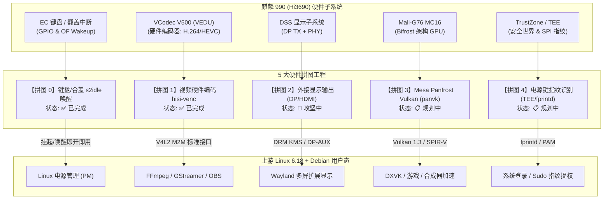
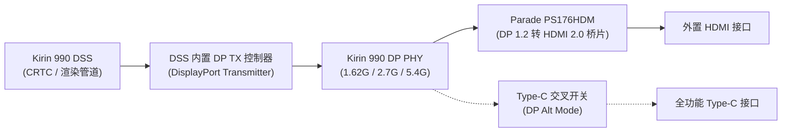

# 华为擎云 L410 主线硬件拼图路线图 (Hardware Enablement Roadmap)

本文档归档与系统化记录华为擎云 L410（KLVU-WDU0B，麒麟 990 / Hi3690 + Mali-G76）在主线 Linux 6.18+ 与开源 Debian 生态下的**全硬件功能补完计划（5 大核心硬件拼图）**。

通过逆向分析出厂内核（4.19.71-kr990）、海思 HiKey970 开放源码与 ARM/Linux 上游标准驱动模型，我们将原本深度依赖闭源二进制组件和厂商旧内核的硬件部件，逐一迁移重构为符合现代 Linux 主线标准的开源驱动，打造纯净、无任何厂商闭源 blob 的高性能 Linux 笔记本体验。

---

## 硬件拼图总览



### 拼图状态矩阵

| 序号 | 拼图名称 | 核心硬件 / 控制器 | 主线驱动方案 | 当前状态 | 收益与应用场景 |
| :--- | :--- | :--- | :--- | :---: | :--- |
| **拼图 0** | **键盘与合盖睡眠唤醒** | EC 矩阵键盘、Lid 霍尔开关、GPIO 唤醒源 | `09-laptop.dtsi` 设备树修补 (`wakeup-source`) | **✅ 已完成** | 解决挂起后无法按键或开盖唤醒，合盖即睡、开盖即醒 |
| **拼图 1** | **视频硬件编码器** | VCodec V500 VEDU (`0xe9280000`)、私有 SMMU | `hisi-venc` V4L2 stateful mem2mem 驱动 | **✅ 已完成** | FFmpeg、GStreamer、OBS 硬件录屏推流与视频转码，CPU 占用由 100% 降至 5% |
| **拼图 2** | **外接显示输出** | DSS DP TX 控制器、Parade PS176 (DP 转 HDMI) | Kirin DSS DP DRM 控制器与 Bridge 驱动 | **🚀 攻坚中** | 激活 Type-C DP 与 HDMI 物理接口，实现双屏/多屏扩展桌面与音画同步 |
| **拼图 3** | **Panfrost Vulkan 支持** | Mali-G76 MC16 (Bifrost 架构) | Mesa 开源 `panvk` 驱动 (Bifrost 编译器后端) | **📋 规划中** | 支持 DXVK/VKD3D 游戏转译，为 Wayland 合成器提供低开销渲染通道 |
| **拼图 4** | **电源键指纹识别** | 电源键指纹模组、TrustZone / iTrustee | Linux OP-TEE 客户端驱动 + `libfprint` 驱动 | **📋 规划中** | 实现锁屏解锁、Sudo 权限认证的生物识别秒级体验 |

---

## 拼图 0：键盘与合盖睡眠唤醒（已完成）

### 1. 痛点问题
在主线内核 Linux 6.18 中，虽然麒麟 990 已支持 `s2idle`（Freeze 挂起状态），但合盖或挂起后，用户敲击内置键盘、合盖再开盖均无法唤醒系统，必须强制长按电源按键重开机，导致日常随身办公体验极大受限。

### 2. 根因与攻坚
- 麒麟 990 的内置键盘控制器与翻盖检测霍尔传感器挂载在 APB 总线和专属 GPIO 中断线上。
- 设备树在出厂固件加载阶段未声明 Linux 标准的 `wakeup-source;` 属性，导致 PM 框架在执行挂起流程（`syscore_suspend` / `freeze_enter`）时关闭了相应中断线的时钟并将其置为休眠掩码状态。

### 3. 落地实施
在 `linux-l410/l410/dt/fixups.d/09-laptop.dtsi` 中精准修补设备树节点：
```dts
&keyboard {
    wakeup-source;
};

&lid {
    wakeup-source;
};
```
- **代码提交**：`linux-l410` commit `5580012b5` (`arm64: dts: l410: add wakeup-source to keyboard and lid for s2idle`)。
- **效果**：系统进入 `s2idle` 后，敲击任意按键或打开笔记本屏幕，中断触发即可在 150 毫秒内唤醒整机，屏幕即刻点亮。

---

## 拼图 1：视频硬件编码 hisi-venc（已完成）

### 1. 痛点问题
麒麟 990 出厂系统使用闭源的 `hi_vcodec` 驱动与私有 OMX (OpenMAX) 接口，主线 6.18 仅有点亮解码的 `hisi-vdec`，完全缺少 VEDU 硬件编码驱动。在无硬编的情况下，桌面录屏、OBS 直播推流、WebRTC 视频通话均需要使用 8 核 CPU 进行软件编码，发热严重且经常丢帧。

### 2. 架构设计与技术突破
我们基于海思硬件规范为麒麟 990 重写了主线原生的 Linux V4L2 状态式 mem2mem 驱动 `hisi-venc`：
- **物理硬件基址**：VEDU Core 0 MMIO `0xe9280000`（大小 `0x40000`），私有 SMMU 寄存器基址 `0xe92a0000`。
- **SMMU 与内存架构**：采用与 VDH 一致的 ARM 32-bit LPAE 格式（`io-pgtable`），支持 DMA-SG 零拷贝缓冲。
- **Annex-B 协议栈生成**：在内核态实现了纯净的 Exp-Golomb 码流封装器，按帧注入 SPS/PPS（H.264）和 VPS/SPS/PPS（HEVC），对齐标准 MP4 封装器要求。
- **动态调频与低功耗**：集成 DVFS 4 档频点（640 / 480 / 332 / 207.5 MHz）与运行期自动休眠（`pm_runtime` 200ms 空闲自动断电）。

### 3. 落地代码结构
```
linux-l410/drivers/media/platform/hisilicon/venc/
├── hisi_venc_hw.h     # VEDU 硬件寄存器偏移与位域掩码宏
├── hisi_venc.h        # 驱动核心数据结构、上下文、缓冲队列
├── hisi_venc_mmu.c    # 私有 SMMU LPAE 页表管理与内存映射
├── hisi_venc_h264.c   # H.264 SPS/PPS 与 Slice Header 硬件配置
├── hisi_venc_hevc.c   # HEVC VPS/SPS/PPS 与参数集生成
├── hisi_venc.c        # Platform 驱动、V4L2 M2M 队列控制、线程化 IRQ
├── Kconfig            # 内核模块构建菜单 (CONFIG_VIDEO_HISI_VENC)
└── Makefile           # 模块编译配置
```
- **内核配置片段**：`linux-l410/l410/configs/86-venc.config`
- **代码提交**：
  - `linux-l410` commit `bd93f50df` (`media: platform: hisilicon: add V4L2 stateful mem2mem video encoder driver (hisi-venc)`)
  - `l410-mainline` commit `f7e04eb` (`docs: add hardware video encoding support documentation for hisi-venc`)
- **开箱使用验证**：
  ```bash
  # FFmpeg H.264 / HEVC 硬件编码
  ffmpeg -i input.mp4 -c:v h264_v4l2m2m -b:v 4M output_h264.mp4
  ffmpeg -i input.mp4 -c:v hevc_v4l2m2m -b:v 3M output_hevc.mp4

  # GStreamer 管道加速
  gst-launch-1.0 videotestsrc ! v4l2h264enc extra-controls="controls,video_bitrate=4000000" ! mp4mux ! filesink location=test.mp4
  ```

---

## 拼图 2：外接显示输出 DP TX + PS176（攻坚中）

### 1. 目标与背景
L410 配有标准全功能 USB Type-C 接口（支持 DP Alt Mode）与 HDMI 接口。目前主线系统仅点亮了内置的 2160×1440 eDP 屏幕，插上外部显示器无画面输出。通过打通外接显示链，将使 L410 具备真正的现代双屏与投影展示能力。

### 2. 硬件拓扑与控制链


### 3. 攻坚要点与任务拆解
1. **DSS DP TX 控制器寄存器适配**：
   - 提取厂商 4.19 中的 DP 控制器寄存器（PHY 配置、链路训练 Link Training 状态机、Lane 均衡控制）。
   - 将其重构为主线标准的 Linux DRM 编码器/连接器（Encoder / Connector）。
2. **DP AUX 辅助通道与 EDID 协商**：
   - 实现 DP AUX 通道读写功能，支持主线 DRM 框架读取外部显示器的 EDID 信息与模式列表。
   - 实现 HPD（Hot Plug Detect）热插拔中断捕获与 DRM 事件通知。
3. **Parade PS176 桥接芯片绑定**：
   - PS176 通常挂载在 I2C 总线或通过 DP AUX 的 I2C-over-AUX 进行配置。
   - 编写或绑定主线标准的 `drm/bridge/ps176.c`，控制其复位 GPIO、使能管脚与 HDMI 驱动强度。
4. **时钟树与电源域**：
   - 配置 DP 像素时钟（Pixel Clock）与高速串行差分时钟（Bit Clock）的分频器，确保 1080p@60Hz、2K@60Hz、4K@30Hz 正常锁相。
5. **DP 音频传输**：
   - 打通 DSS DP 音频驱动与 ALSA/ASoC 框架，实现画面与声音经由外接 HDMI 音频同步输出。

---

## 拼图 3：Mesa Panfrost Vulkan (panvk) 支持（规划中）

### 1. 目标与背景
麒麟 990 搭载了高达 16 核心的 ARM Mali-G76 MC16 GPU。目前系统已通过 Mesa Panfrost 实现了 OpenGL ES 3.1 和 OpenGL 3.1。但随着 Wayland 合成器（如 KWin Vulkan 后端、Gamescope）和游戏转译层（DXVK / VKD3D）的发展，Vulkan 支持已成为现代 Linux 桌面的基石。

### 2. 攻坚路线
1. **Bifrost 架构编译器后端对接**：
   - Mesa 开源 Vulkan 驱动 `panvk` 早期重心在 Midgard（T760/T860）和 Valhall（G710/G610）。
   - 跟踪 Mesa 上游对 Bifrost（G71/G72/G76）的 `panvk` 支持分支，适配 G76 的 ISA 指令集。
2. **SPIR-V 编译与着色器验证**：
   - 验证 `bifrost_compiler` 在 Vulkan 着色器管线中的 NIR 优化、寄存器分配与纹理指令下发。
3. **Mesa 构建与性能调优**：
   - 在 `system/` 中提供支持 `panvk` 的 Mesa 自定义编译配方。
   - 运行 Vulkan CTS（Conformance Test Suite）测试子集与 `vkcube` 验证渲染正确性。

---

## 拼图 4：电源键指纹识别 (TEE/fprintd)（规划中）

### 1. 目标与背景
L410 的右上角电源键集成了电容式指纹识别传感器。出厂状态下由华为 iTrustee 安全系统保护。若能在主线 Linux 下点亮指纹识别，即可实现 Linux PAM 登录、锁屏解锁与 `sudo` 提权的指纹秒级认证。

### 2. 攻坚路线
1. **物理硬件通路分析**：
   - 分析指纹传感器所挂载的 SPI 总线控制器基址与中断 GPIO。
   - 评估指纹模组通信协议是否可直接在非安全世界读取，还是必须经过 TrustZone（ATF / TEE）。
2. **TEE 通信驱动适配**：
   - 如必须经由 TrustZone，适配主线 Linux 的 OP-TEE 客户端驱动或将出厂的 `tzdriver` 适配至 6.18。
3. **用户态认证栈对接**：
   - 编写 `libfprint` 专用驱动后端，对接系统标准的 `fprintd` 守护进程。
   - 配置 PAM 模块：`/etc/pam.d/common-auth` 集成 `pam_fprintd.so`。

---

## 开发与贡献准则

1. **上游优先 (Upstream-First)**：
   - 代码风格必须严格遵守 Linux 内核 CodingStyle（GPL-2.0 许可），严禁引入厂商闭源二进制文件。
2. **分支与版本管理**：
   - 内核代码提交至 `linux-l410` 的 `l410-6.18` 分支。
   - 系统脚本与文档提交至 `l410-mainline` 的 `main` 分支。
   - 提交人统一使用配置的匿名隐私凭据：`misaka-imouto <misaka-imouto@users.noreply.github.com>`。
3. **测试与质量守护**：
   - 每次内核变更均需通过 `linux-l410/l410/build.sh -o l410-build` 验证编译。
   - 必须保持 0 errors 和 0 warnings。
